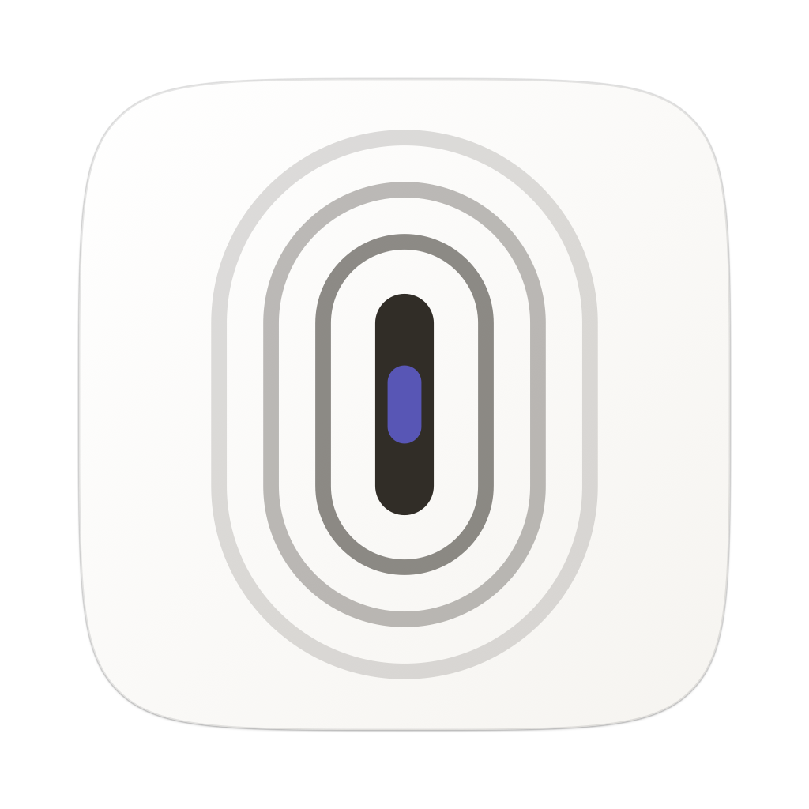
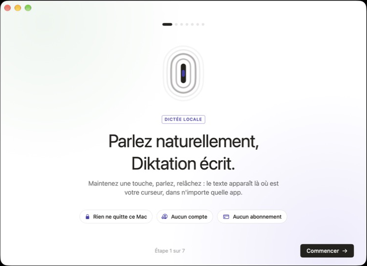

<p align="center">
  
</p>

<h1 align="center">Diktation</h1>

<p align="center">
  <b>Parlez naturellement, Diktation écrit.</b><br>
  Dictée vocale privée et hors ligne pour macOS. Maintenez une touche, parlez, relâchez : le texte apparaît là où est votre curseur.
</p>

<p align="center">
  <a href="https://github.com/Senooy/Diktation/releases/latest"><b>Télécharger pour Mac</b></a> ·
  <a href="README.md">Read in English</a>
</p>

<p align="center">
  
</p>

---

Diktation est une alternative libre et gratuite aux apps de dictée par abonnement. La reconnaissance vocale tourne **entièrement sur votre Mac** avec [whisper.cpp](https://github.com/ggml-org/whisper.cpp), sur le GPU (Metal). Pas de compte, pas de cloud, pas d'abonnement, pas de télémétrie. Votre voix et vos textes ne quittent jamais la machine.

## Fonctions

- **Maintenir pour dicter, partout.** Maintenez <kbd>fn</kbd> dans n'importe quelle app, parlez, relâchez : le texte est collé au curseur. Une phrase revient en bien moins d'une seconde sur puce Apple.
- **Mains libres.** Deux appuis rapides sur <kbd>fn</kbd> pour écouter sans tenir la touche ; un nouvel appui termine. <kbd>esc</kbd> annule.
- **Texte propre.** Ponctuation et majuscules par le modèle, hésitations (« euh », « heu ») retirées, commandes vocales « à la ligne » et « nouveau paragraphe ».
- **Style selon l'app** *(Apple Intelligence, sur le Mac)*. Emails soignés, messagerie pro neutre, messages perso décontractés. Un ton par catégorie, ou la dictée brute.
- **Mode commande** *(Apple Intelligence, sur le Mac)*. Sélectionnez du texte, maintenez <kbd>fn</kbd> + <kbd>⌃</kbd> et dites quoi en faire : « rends ça plus poli », « traduis en anglais », « fais-en une liste ». Sans sélection, Diktation rédige ce que vous demandez.
- **Dictionnaire personnel.** Noms propres, marques et jargon sont soufflés au modèle avant chaque dictée, plus des corrections automatiques pour les mots qu'il écorche toujours.
- **Raccourcis vocaux.** Dites « mon adresse mail » et Diktation la tape. Pareil pour une signature, un lien, une réponse type.
- **Historique.** Chaque dictée reste sur le Mac, avec recherche et audio pour re-transcrire. Suppression automatique après 24 h en option. <kbd>⌃</kbd><kbd>⌘</kbd><kbd>V</kbd> recolle la dernière.
- **Une petite pastille flottante** montre l'app où vous dictez et la forme d'onde en direct, puis s'efface.
- **Interface en français ou en anglais**, selon la langue du Mac. La dictée fonctionne dans de nombreuses langues (français, anglais, espagnol, allemand, italien, arabe, détection auto…).

## Configuration requise

- Un Mac à **puce Apple** (M1 ou plus récent).
- **macOS 14 Sonoma** ou plus récent. Le style selon l'app et le mode commande demandent **macOS 26** avec Apple Intelligence activé ; tout le reste fonctionne sans.
- Environ **1,7 Go** d'espace libre pour le modèle recommandé (un modèle compact de 574 Mo est aussi proposé).

## Installation

1. Téléchargez `Diktation-<version>.dmg` depuis la [dernière version](https://github.com/Senooy/Diktation/releases/latest).
2. Ouvrez-le et glissez **Diktation** dans **Applications**. L'app est signée et notarisée par Apple.
3. Lancez-la. L'accueil vous guide pas à pas :
   - téléchargement du modèle de transcription (avec progression, reprise possible),
   - autorisation du **micro**,
   - autorisation **Accessibilité** (raccourci global et collage dans les autres apps),
   - vérification du raccourci, puis première dictée.

> **Astuce :** si l'appui sur <kbd>fn</kbd> ouvre aussi les emojis ou la dictée d'Apple, réglez **Réglages Système → Clavier → « Touche 🌐 » → « Ne rien faire »**, ou choisissez un autre raccourci dans les réglages de Diktation (toute combinaison de modificateurs, par exemple <kbd>⌥</kbd> droite).

## Utilisation

| Geste | Effet |
|---|---|
| Maintenir <kbd>fn</kbd> | Écoute ; relâcher pour transcrire et coller |
| Deux appuis sur <kbd>fn</kbd> | Mains libres ; un appui pour terminer |
| <kbd>esc</kbd> pendant l'écoute | Annuler |
| Maintenir <kbd>fn</kbd> + <kbd>⌃</kbd> | Mode commande sur le texte sélectionné |
| <kbd>⌃</kbd> <kbd>⌘</kbd> <kbd>V</kbd> | Recoller la dernière dictée |
| Dire « à la ligne » / « nouveau paragraphe » | Saut de ligne ou de paragraphe |

L'icône de la barre des menus donne accès à la fenêtre, à la dernière dictée et à Quitter. Fermer la fenêtre laisse Diktation tourner en arrière-plan.

## Confidentialité

- L'audio n'est capté que pendant la dictée ; le reste du temps, le flux micro est en pause.
- La transcription tourne en local avec whisper.cpp. Le style et le mode commande utilisent le modèle d'Apple sur l'appareil (framework FoundationModels).
- Le seul accès réseau est le téléchargement initial du modèle depuis le [dépôt officiel de whisper.cpp sur Hugging Face](https://huggingface.co/ggerganov/whisper.cpp).
- Historique, audio et réglages sont dans `~/Library/Application Support/Diktation`. Supprimez ce dossier pour tout effacer.

## Modèles

| Modèle | Taille | Remarques |
|---|---|---|
| Turbo (`ggml-large-v3-turbo`) | 1,6 Go | Recommandé : le meilleur équilibre précision / vitesse |
| Turbo compact (`ggml-large-v3-turbo-q5_0`) | 574 Mo | Quantifié, presque aussi précis |
| Large v3 (`ggml-large-v3`) | 3,1 Go | Le plus précis, plus lent |
| Small (`ggml-small`) | 488 Mo | Le plus rapide |

Les modèles sont cherchés dans `~/Library/Application Support/Diktation/models` et `~/.cache/whisper`. On en change à tout moment dans **Réglages → Modèle de transcription**.

## Compiler soi-même

Il faut les outils en ligne de commande de Xcode, Rust (via [rustup](https://rustup.rs)) et CMake.

```sh
git clone https://github.com/Senooy/Diktation.git
cd Diktation
./bundle.sh          # compile le cœur Rust et l'app SwiftUI, puis signe Diktation.app
open Diktation.app
```

`./release.sh` produit un DMG notarisé (certificat Developer ID et profil `notarytool` requis, voir l'en-tête du script). L'architecture est décrite dans le [README anglais](README.md#how-it-works).

## Licence

[MIT](LICENSE) © 2026 Younes Khelifi
