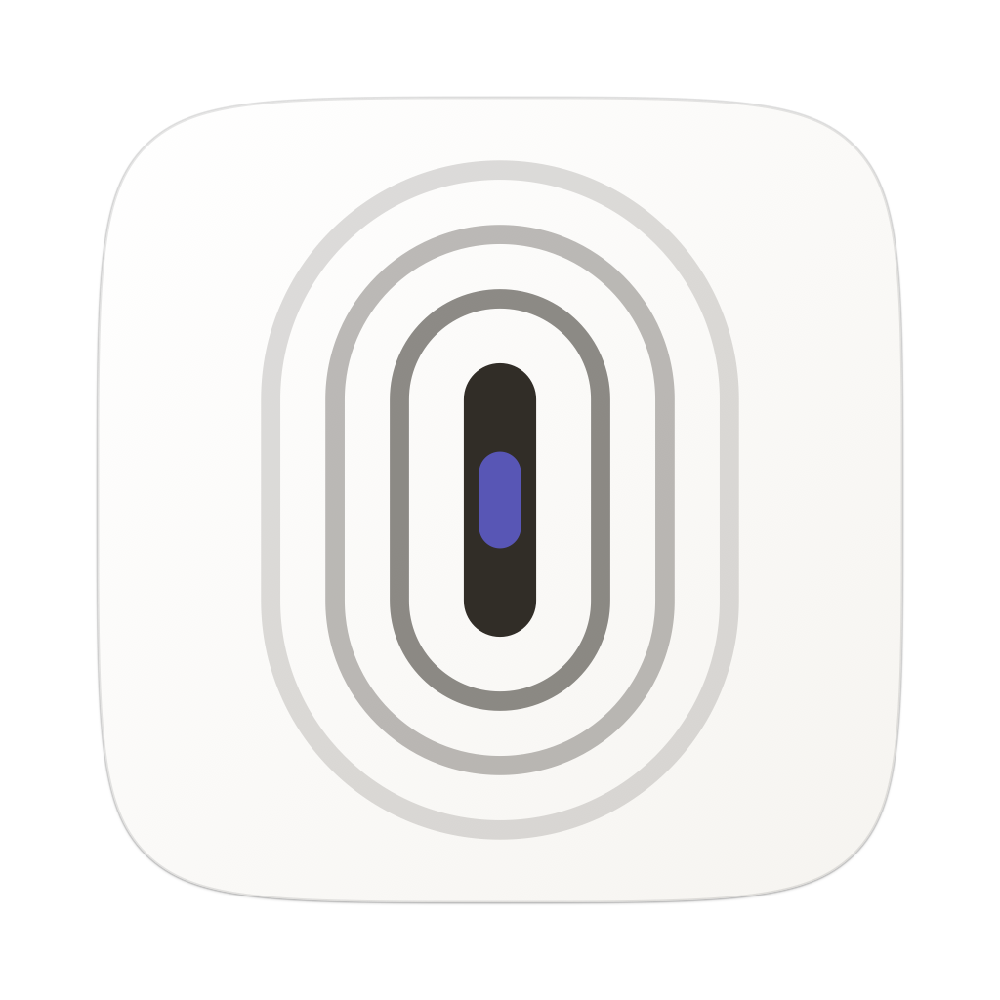
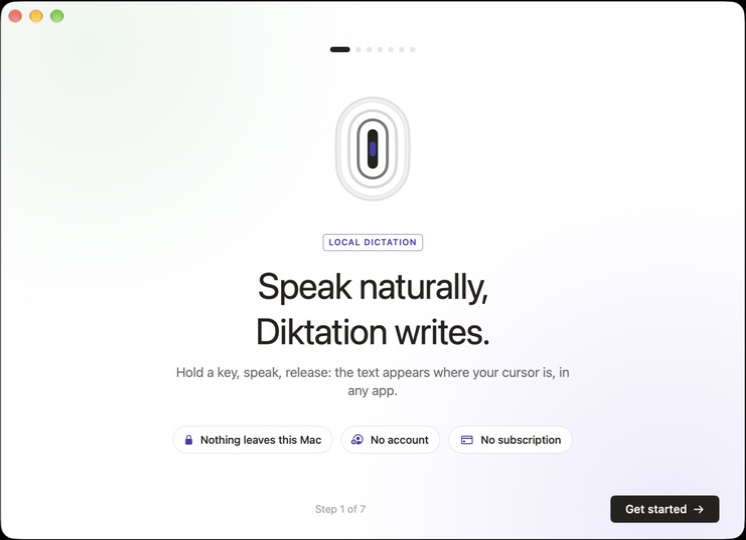
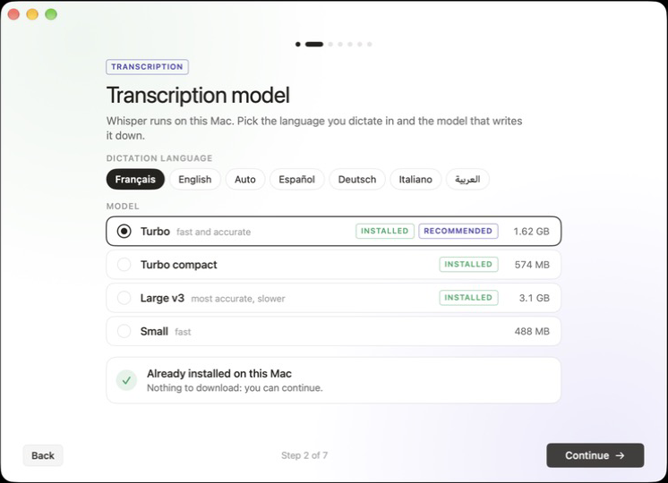

<p align="center">
  
</p>

<h1 align="center">Diktation</h1>

<p align="center">
  <b>Speak naturally, Diktation writes.</b><br>
  Private, offline voice dictation for macOS. Hold a key, talk, let go: your words appear where your cursor is.
</p>

<p align="center">
  <a href="https://github.com/Senooy/Diktation/releases/latest"><b>Download for Mac</b></a> ·
  <a href="README.fr.md">Lire en français</a>
</p>

<p align="center">
  
</p>

---

Diktation is a free, open-source alternative to subscription dictation apps. Speech recognition runs **entirely on your Mac** with [whisper.cpp](https://github.com/ggml-org/whisper.cpp) on the GPU (Metal). No account, no cloud, no subscription, no telemetry. Your voice and your text never leave the machine.

## Features

- **Hold to dictate, anywhere.** Hold <kbd>fn</kbd> in any app, speak, release: the text is pasted at your cursor. A sentence comes back in well under a second on Apple silicon.
- **Hands-free mode.** Double-tap <kbd>fn</kbd> to keep listening without holding the key; press it again to finish. <kbd>esc</kbd> cancels.
- **Clean text.** Punctuation and capitals from the model, filler words (“um”, “euh”) removed, voice commands such as “new line” and “new paragraph”.
- **Style per app** *(Apple Intelligence, on device)*. Emails come out polished, work chats neutral, personal messages casual. Pick the tone for each category, or keep the raw dictation.
- **Command mode** *(Apple Intelligence, on device)*. Select text, hold <kbd>fn</kbd> + <kbd>⌃</kbd> and say what to do: “make it more polite”, “translate to English”, “turn this into a list”. With nothing selected, Diktation writes what you ask for.
- **Personal dictionary.** Names, brands and jargon are given to the model before each dictation so it spells them right, plus automatic corrections for words it always gets wrong.
- **Voice shortcuts.** Say “my email address” and Diktation types it. Same for signatures, links, canned replies.
- **History.** Every dictation is kept locally, searchable, with the audio for re-transcription. Optional auto-delete after 24 hours. <kbd>⌃</kbd><kbd>⌘</kbd><kbd>V</kbd> pastes the last one again.
- **A small floating pill** shows the app you're dictating into and a live waveform, then gets out of the way.
- **English and French interface**, following your Mac's language. Dictation itself works in many languages (English, French, Spanish, German, Italian, Arabic, auto-detect…).

## Meeting workspace

The **Meetings** sidebar opens a dedicated workspace: choose in-person microphone recording or video-call microphone + Mac audio, read provisional text in 5-second passages, and take personal notes alongside it. Finishing the recording produces a timestamped speaker transcript. Names can be assigned manually, notes are saved automatically, and the whole document can be copied or exported as Markdown. Meetings keep their own audio and history. Video-call mode requests macOS screen/system-audio permission and includes other apps’ audio; use headphones to avoid echo. [Usage and validation notes](docs/mode-reunion.md).

## Speaker analysis and decoding speed

Settings now includes optional fast Whisper decoding and two downloadable speaker models (~47 MB). Keep audio enabled, then use the speakers menu on a history entry to detect voices automatically or specify their count. Results include timestamps and a separate copy action; the original dictation is preserved. Speaker numbers belong to one recording, not to named identities across recordings. Overlapping speech is flagged but not separated into audio tracks.

See the [validation notes and measured limits](docs/transcription-et-intervenants.md) for reproducible commands and latency results.

## Requirements

- A Mac with **Apple silicon** (M1 or later).
- **macOS 14 Sonoma** or later. Style per app and command mode need **macOS 26** with Apple Intelligence turned on; everything else works without it.
- About **1.7 GB** of free space for the recommended model (a 574 MB compact model is offered too).

## Install

1. Download `Diktation-<version>.dmg` from the [latest release](https://github.com/Senooy/Diktation/releases/latest).
2. Open it and drag **Diktation** to **Applications**. The app is signed and notarized by Apple.
3. Launch it. The welcome screens walk you through everything:
   - download the transcription model (with progress, resumable),
   - allow the **microphone**,
   - allow **Accessibility** (needed for the global shortcut and for pasting into other apps),
   - check your shortcut, then try your first dictation.

<p align="center"></p>

> **Tip:** if pressing <kbd>fn</kbd> also opens the emoji picker or Apple's dictation, set **System Settings → Keyboard → “Press 🌐 key to” → “Do Nothing”**, or choose another shortcut in Diktation's settings (any modifier combination, e.g. right <kbd>⌥</kbd>).

## Using it

| Gesture | What happens |
|---|---|
| Hold <kbd>fn</kbd> | Listen; release to transcribe and paste |
| Double-tap <kbd>fn</kbd> | Hands-free; tap again to finish |
| <kbd>esc</kbd> while listening | Cancel |
| Hold <kbd>fn</kbd> + <kbd>⌃</kbd> | Command mode on the selected text |
| <kbd>⌃</kbd> <kbd>⌘</kbd> <kbd>V</kbd> | Paste the last dictation again |
| Say “new line” / “new paragraph” | Line or paragraph break |

The menu bar icon gives quick access to the window, the last dictation and Quit. Closing the window moves Diktation to the menu bar: it leaves the Dock and the shortcut stays active. Reopen it from the menu bar icon or by launching the app again.

## Privacy

- The microphone stays active during dictation and for up to 10 seconds afterward to reduce latency between recordings. A 300 ms pre-roll is kept in memory during that period; the stream then pauses.
- Transcription runs locally with whisper.cpp. Style and command mode use Apple's on-device foundation model through the FoundationModels framework.
- Network access checks and downloads app updates through GitHub Releases, and downloads models from the official [whisper.cpp repository on Hugging Face](https://huggingface.co/ggerganov/whisper.cpp) and [sherpa-onnx releases on GitHub](https://github.com/k2-fsa/sherpa-onnx/releases). Transcription and speaker analysis run locally.
- History, audio and settings live in `~/Library/Application Support/Diktation`. Delete that folder to erase everything.

## Models

Pick and download models in **Settings → Transcription model** (or during the first run). Two engines run side by side: [whisper.cpp](https://github.com/ggml-org/whisper.cpp) on the GPU, and [sherpa-onnx](https://github.com/k2-fsa/sherpa-onnx) (ONNX Runtime) for the newer models. Times below are for a 7-second sentence on an M5 Pro, model already loaded.

| Model | Download | Languages | Speed | Notes |
|---|---|---|---|---|
| Whisper Turbo (`large-v3-turbo`) | 1.6 GB | ~100 | ~0.7–1.1 s | Recommended default; follows your dictionary |
| NVIDIA Parakeet TDT v3 | 487 MB | 25 European | ~0.3 s | Very fast, excellent in English and French |
| NVIDIA Nemotron 3.5 ASR (June 2026) | 475 MB | Multilingual | ~1.3 s | Newest NVIDIA model, forced or auto language |
| Qwen3-ASR 0.6B (March 2026) | 879 MB | 52 | ~1.3 s | Recent multilingual model |
| Cohere Transcribe (April 2026) | 1.7 GB | 14 | ~2 s | Most accurate of the newer models |
| NVIDIA Canary 180M flash | 154 MB | en, fr, es, de | ~0.5 s | Ultra light; set the right dictation language (it translates otherwise) |
| NVIDIA Parakeet Unified | 501 MB | English | ~0.3 s | Latest English Parakeet |
| Moonshine base | 111 MB | English | ~0.1 s | Near-instant |
| Whisper Turbo compact, Large v3, Small | 0.5–3.1 GB | ~100 | | Other whisper.cpp sizes |

Only Whisper reads the personal dictionary before transcribing; automatic corrections and voice shortcuts work with every model. Each model keeps its own license (see its page on Hugging Face or in the sherpa-onnx releases). Models are stored in `~/Library/Application Support/Diktation/models` (whisper files in `~/.cache/whisper` are picked up too).

## Build from source

You need the Xcode command line tools, Rust (via [rustup](https://rustup.rs)) and CMake.

```sh
git clone https://github.com/Senooy/Diktation.git
cd Diktation
./bundle.sh          # builds the Rust core and the SwiftUI app, then signs Diktation.app
open Diktation.app
```

Starting with 1.2.0, Sparkle checks for updates automatically and supports background downloads. Controls are in Settings → Updates. Older versions require one final manual installation. See the [distribution guide (French)](docs/mises-a-jour.md) for signing, notarization and GitHub Actions setup.

`./release.sh` builds a notarized DMG (it needs a Developer ID certificate and a `notarytool` keychain profile; see the script header). Command-line tools for testing without the UI:

```sh
target/release/diktation --transcribe sample.wav
target/release/diktation --rewrite com.apple.mail "um hi Marc the quote is ready I'll send it tomorrow"
target/release/diktation --command "translate to French" "I'll get back to you on Monday."
```

The app icon is drawn by `scripts/make_icon.swift` (see its header to regenerate `assets/AppIcon.icns`).

## How it works

Diktation is a single process: a SwiftUI app linking a Rust core built as a static library.

```
SwiftUI app (app/Sources)          Rust core (src/, libdiktation.a)
  windows, onboarding, pill  ◀──▶   C API: dk_start / dk_send / dk_state
  model download                    hotkey  CGEventTap, modifier-only shortcuts
                                    audio   CoreAudio via cpal, 16 kHz, adaptive level meter
                                    engine  whisper.cpp (Metal), kept in memory
                                    text    fillers, corrections, voice shortcuts
                                    macos   paste via ⌘V, clipboard restore, selection
                                    assist  per-app tone, command mode
                                    store   SQLite history
diktation-llm (llm/main.swift)  ◀── Apple Intelligence (FoundationModels), JSON lines
```

The core runs on its own thread and sends the UI two kinds of events: `changed` (re-read the state snapshot) and `pill` (what the floating pill should show, about 30 times a second while listening).

## Acknowledgements

- [Sparkle](https://sparkle-project.org/) for signed macOS updates.

- [whisper.cpp](https://github.com/ggml-org/whisper.cpp) by Georgi Gerganov and contributors, and OpenAI's Whisper models.
- [sherpa-onnx](https://github.com/k2-fsa/sherpa-onnx) by k2-fsa (Apache-2.0) and [ONNX Runtime](https://github.com/microsoft/onnxruntime) (MIT), and the NVIDIA, Alibaba Qwen, Cohere and Useful Sensors teams for their open speech models.
- [whisper-rs](https://github.com/tazz4843/whisper-rs), [cpal](https://github.com/RustAudio/cpal), [objc2](https://github.com/madsmtm/objc2), [rusqlite](https://github.com/rusqlite/rusqlite).

## License

[MIT](LICENSE) © 2026 Younes Khelifi
